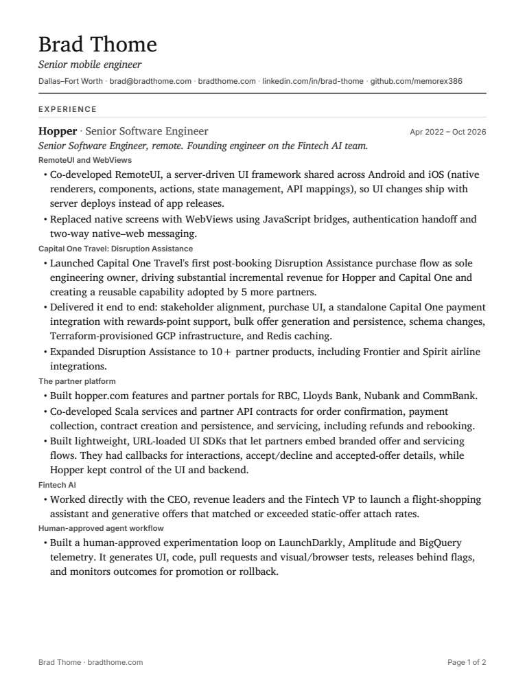
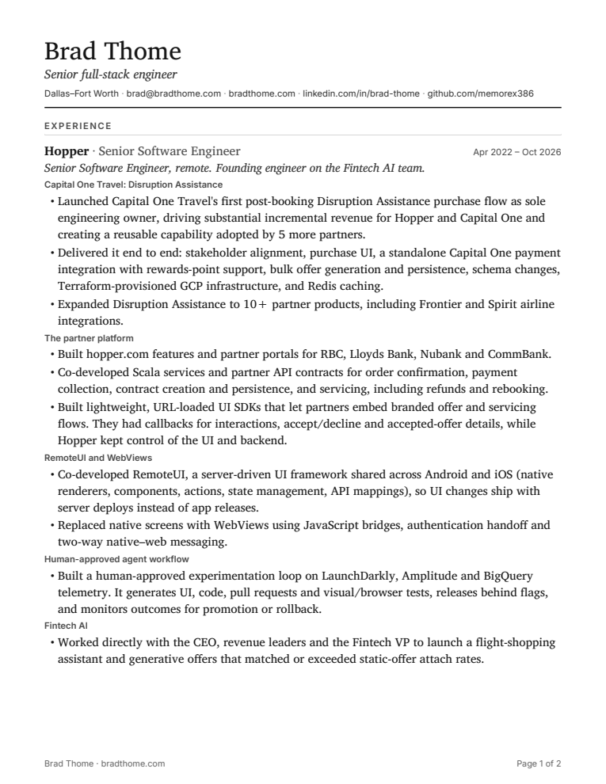
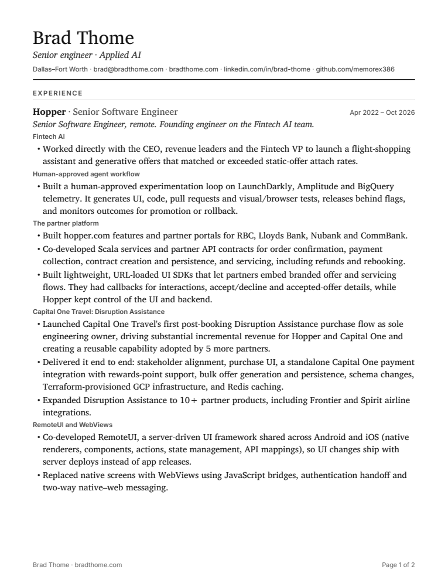
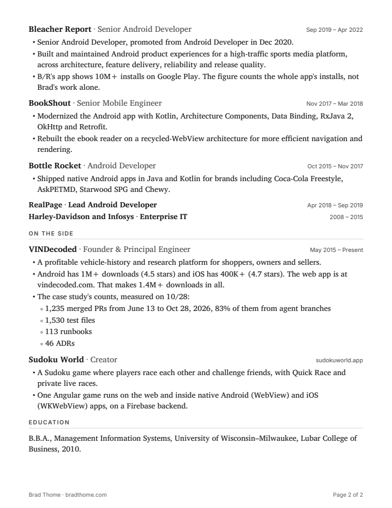

# Spec 015 mocks: Résumé PDFs

"Show it" for [spec 015](../spec.md). Brad approves these with the spec and plan at Gate 1. The spec's scenarios name the state IDs below.

- The mocks are the PDFs themselves, printed from this branch in the pinned container, and the images below are their pages. The pull request's preview serves them at `/resume/brad-thome-mobile.pdf`, `/resume/brad-thome-full-stack.pdf` and `/resume/brad-thome-applied-ai.pdf`.
- The look is the Resume PDF board's (D118). The words are the role page's claims, in its order (D6, D134), with D137's contact line.

## Every state

| ID                | State                                                                                                                                  | Scenarios        |
| ----------------- | -------------------------------------------------------------------------------------------------------------------------------------- | ---------------- |
| P1 | Page 1: the name, the role's line, the contact line, then Experience with Hopper, its topics in the role's order                        | S1.2–S1.5        |
| P2 | Page 2: the other jobs, the dated lines, "On the side" and Education. It's the same for every role, since only Hopper's topics move    | S1.3, S1.5, S2.2 |
| B1 | The hero's "Read the résumé" on each page, which looks as it does today and opens the page's PDF; on `/v2`, the full-stack PDF         | S1.1             |

## The pages

| Role       | Page 1                                      | Page 2                                      |
| ---------- | ------------------------------------------- | ------------------------------------------- |
| Mobile     |             |             |
| Full-stack |      |      |
| Applied AI |             |             |

## Hopper's topics on page 1

| PDF        | Topics, after the role lines                                                                 |
| ---------- | -------------------------------------------------------------------------------------------- |
| Mobile     | RemoteUI and WebViews, Disruption Assistance, the partner platform, Fintech AI, agent workflow |
| Full-stack | Disruption Assistance, the partner platform, RemoteUI and WebViews, agent workflow, Fintech AI |
| Applied AI | Fintech AI, agent workflow, the partner platform, Disruption Assistance, RemoteUI and WebViews |

## From the board, left out

The board's draft words with no public claim behind them don't print: its summary paragraph, its "Remote", "Richardson, TX" and "DFW" labels, its "1,235 PRs in 4½ months" line, its skills section and its "Continued:" footer.
